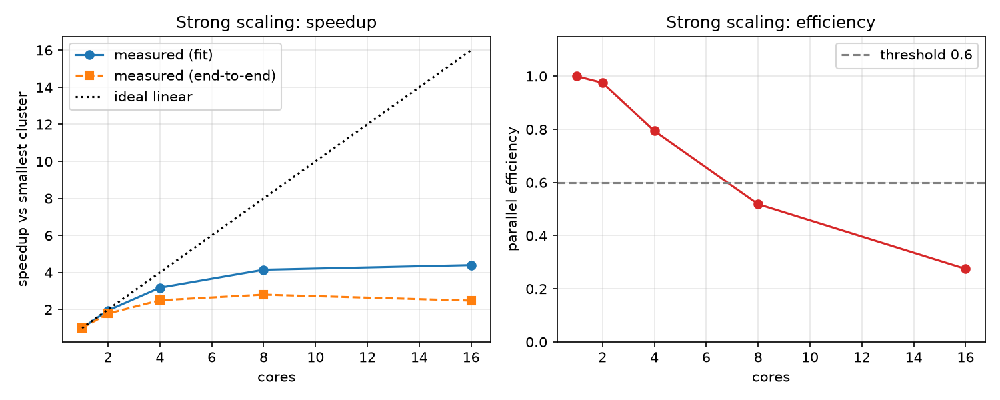
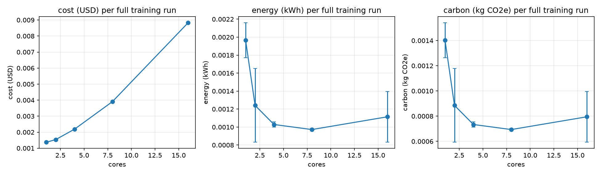
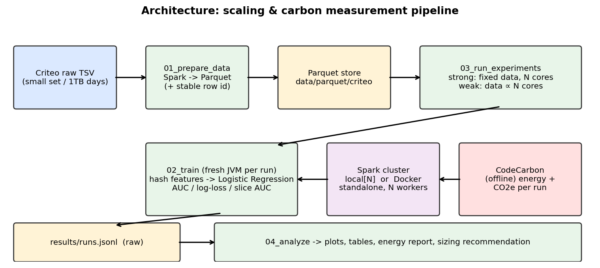
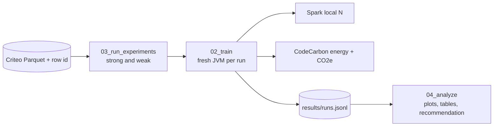

# Distributed Training and Its Carbon Footprint

**BDSRAE Level 3 project** · Team: Sai Likhith S (PES1UG24AM239) · Samarth S A (PES1UG24AM243) · Nikhil Tej (PES1UG24AM311)

How does training time, cost, energy and carbon change as we add machines? We train a click-prediction model on the **Criteo** ad logs with **Apache Spark** at several cluster sizes, measure **strong and weak scaling**, estimate **energy and CO2e with CodeCarbon**, and find the point where **adding machines stops being worthwhile**.

This repository is **Part 1 of 3**: the core experiment, analysis and results. Part 2 (data pipeline) and Part 3 (Docker cluster + results notebook) are maintained separately by the team.

## Key results (real Criteo data, 1M-row subset, medians of 3 runs)

| Cores | Fit time (s) | Speedup | Efficiency | AUC |
|---|---|---|---|---|
| 1 | 59.5 | 1.00 | 1.00 | 0.759 |
| 2 | 30.5 | 1.95 | 0.98 | 0.759 |
| 4 | 18.7 | 3.18 | 0.79 | 0.759 |
| 8 | 14.3 | 4.15 | 0.52 | 0.759 |
| 16 | 13.5 | 4.40 | 0.27 | 0.759 |

**Recommended size: 4 cores.** Beyond that, each added core buys little time while cost and carbon keep rising. Accuracy is identical at every size. Full write-up: [`docs/technical_report.md`](docs/technical_report.md).




| Required component | How this project covers it |
|---|---|
| **Big data systems** | Distributed training in Spark, strong/weak scaling, cost model |
| **Responsible AI** | Measured energy/carbon per run, transparent reporting of measurement limits, quality guard across data slices, model card |

## Architecture




## Repository layout
```
scripts/02_train.py                one configuration: train, evaluate, measure time/cost/energy/carbon
scripts/03_run_experiments.py      strong + weak scaling sweep with repeats
scripts/04_analyze.py              tables, plots, marginal analysis, sizing recommendation
src/common.py                      Spark session + EnergyMeter (CodeCarbon, with TDP fallback)
docs/technical_report.md           technical report
MODEL_CARD.md                      model card
results/                           raw results (runs.jsonl), plots, summaries
results/v1_hb18/                   first sweep (2^18 buckets), discarded - see report
```

## Setup
Requirements: Python 3.10+, **Java 11/17/21** (needed by Spark), ~8 GB RAM recommended.
```bash
git clone https://github.com/samarth2006-28/Big-Data-.git && cd Big-Data-
python3 -m venv .venv && source .venv/bin/activate
pip install -r requirements.txt
```
On Windows, if your computer name contains an underscore, set `SPARK_LOCAL_HOSTNAME=localhost` first.

### Input data
The scripts expect a Parquet dataset with columns `label`, `I1`-`I13`, `C1`-`C26` and a stable row id `rid`. It is built from the Criteo Display Advertising Challenge data ([Kaggle mirror](https://www.kaggle.com/datasets/mrkmakr/criteo-dataset)) by the team's data pipeline (Part 2). Raw data is not committed.

### Run the scaling experiments (local cores = simulated cluster)
```bash
python scripts/03_run_experiments.py --data data/parquet/criteo_1m --cores-list 1 2 4 8 16 --repeats 3 --hash-bits 14 --max-iter 10 --driver-mem 6g --executor-mem 6g
```
Each run is appended to `results/runs.jsonl`. Do not edit this file by hand.

### Analyse
```bash
python scripts/04_analyze.py        # writes plots, summary CSVs, results/recommendation.md
```

## What gets measured (per run)
`load_s`, `fit_s`, `eval_s`, `total_s` · `auc`, `logloss`, slice AUC (`I1` missing/present) · `energy_kwh`, `co2e_kg` (+ `method`: `codecarbon` or `tdp_fallback`) · `cost_usd` (= cores × hours × price per vCPU-hour) · host details and hyper-parameters.

## Interpreting the sizing recommendation
`04_analyze.py` recommends the **largest cluster whose strong-scaling parallel efficiency ≥ 0.6 and whose runtime is ≥ 15% lower than the previous size**. Change with `--efficiency-threshold` and `--min-marginal-gain`. It also prints the fastest, cheapest and lowest-carbon sizes and the marginal time saved per extra gram CO2e.

## Limitations (summary; details in report)
CodeCarbon gives estimates, not metered power; `local[N]` has no network; a 1M-row subset (2.2% of the small Criteo set) means fixed overheads weigh heavily at 8-16 cores; one model family; anonymised features prevent group-fairness auditing.

# Criteo Data Pipeline (Part 2 of 3)

Data preparation for the project *Distributed Training and Its Carbon Footprint*. It turns the raw Criteo click logs into the Parquet files the scaling experiments use. Core experiment and results (Part 1): https://github.com/samarth2006-28/Big-Data-

```
scripts/00_generate_synthetic.py   synthetic Criteo-format data (pipeline testing only)
scripts/01_prepare_data.py         TSV -> Parquet, adds a stable row id `rid`
scripts/01b_make_subset.py         deterministic row subset (same rows every time)
src/common.py                      Criteo schema + Spark session helper
docs/data_card.md                  data card
```

## Setup
Python 3.10+ and **Java 11/17/21**.
```bash
pip install -r requirements.txt
```
On Windows, if your computer name contains an underscore, set `SPARK_LOCAL_HOSTNAME=localhost` first.

## Quick test (synthetic data, about 1 minute)
```bash
python scripts/00_generate_synthetic.py --rows 50000 --out data/raw/synth.tsv
python scripts/01_prepare_data.py --input data/raw/synth.tsv --out data/parquet/criteo
```

## Real data
1. Download `train.txt` (Criteo Display Advertising Challenge, 45,840,617 rows, 11.1 GB) from https://www.kaggle.com/datasets/mrkmakr/criteo-dataset into `data/raw/`. Read the licence terms on the download page.
2. Convert to Parquet (about 3.1 GB):
   ```bash
   python scripts/01_prepare_data.py --input data/raw/train.txt --out data/parquet/criteo_full --partitions 64
   ```
3. Make the 1M-row subset used for all reported results:
   ```bash
   python scripts/01b_make_subset.py --data data/parquet/criteo_full --rows 1000000 --out data/parquet/criteo_1m
   ```

The subset is chosen by hashing `rid`, so everyone gets exactly the same 1,000,612 rows. Raw data is never committed (`data/` is git-ignored).

## Responsible use and data
Public anonymised data only, no re-identification attempted, raw data not committed. See `MODEL_CARD.md`.

## Team and credits
Course: Big Data Systems & Responsible AI Engineering (BDSRAE), Level 3. Criteo for the dataset; Apache Spark; CodeCarbon.

