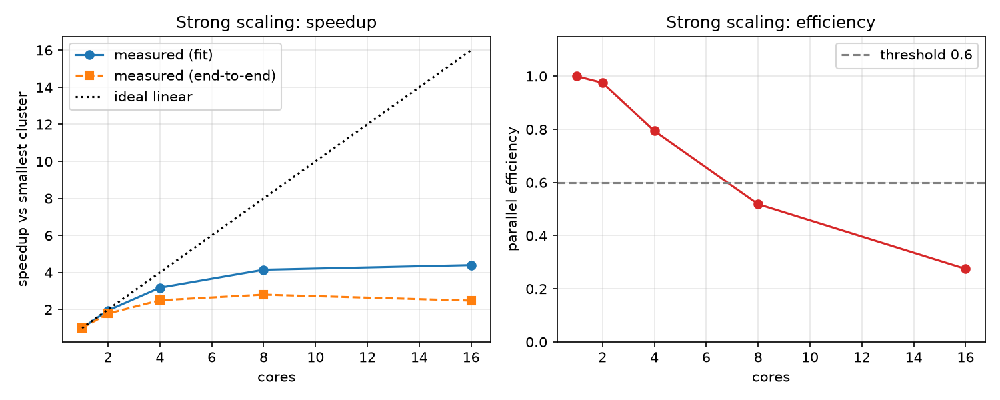
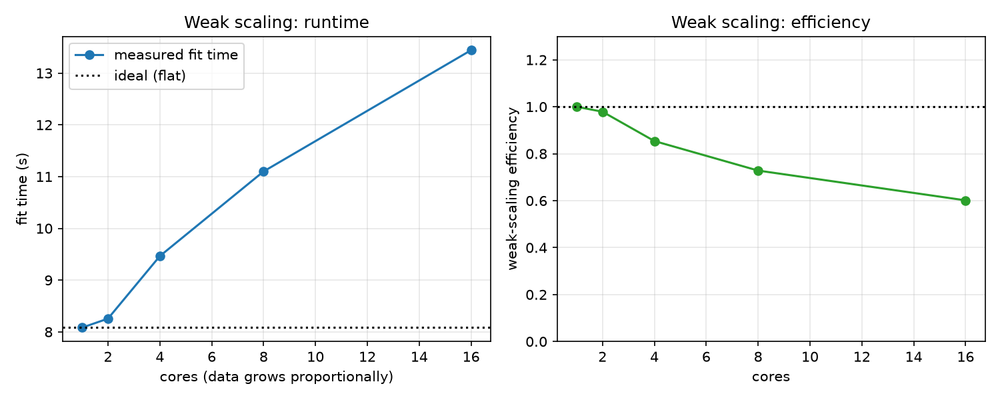
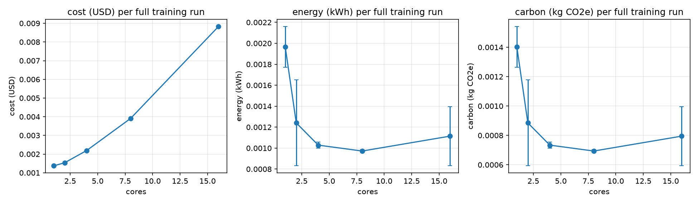
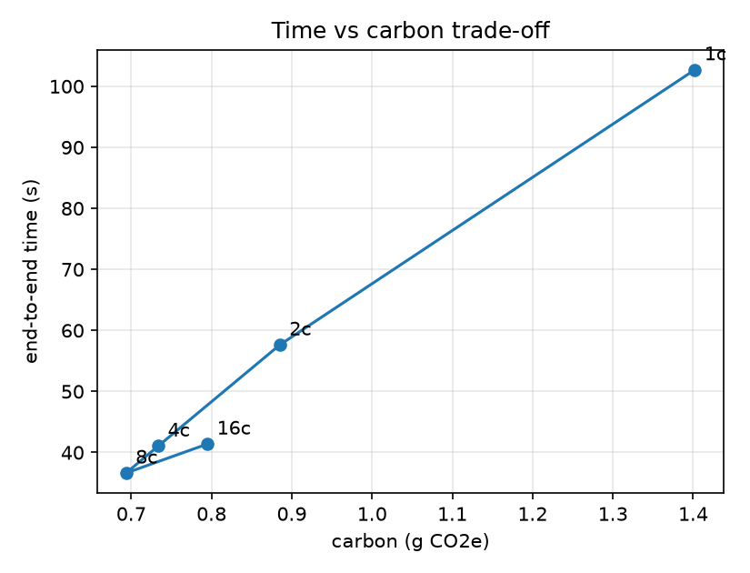
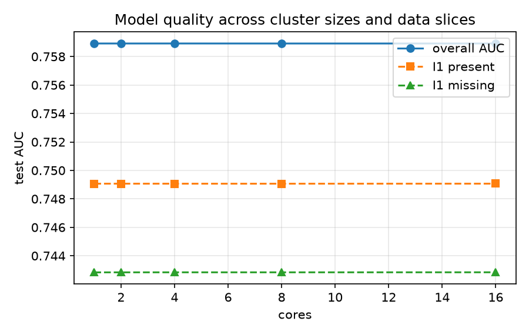

# Distributed Training and Its Carbon Footprint: Technical Report
**Team:** Sai Likhith S (PES1UG24AM239), Samarth S A (PES1UG24AM243), Nikhil Tej (PES1UG24AM311)
**Course:** BDSRAE Level 3 · **Repo:** https://github.com/samarth2006-28/Big-Data-

## 1. Problem and motivation
An ad platform trains click-prediction models on very large logs. Adding machines shortens training but increases cost and energy, and parallel efficiency usually falls as clusters grow. We ask: **at what cluster size does adding machines stop being worthwhile once time, money and carbon are all counted?** We study this with Spark on the Criteo click logs and report scaling behaviour, an energy/carbon estimate per run, and a sizing recommendation. (Big-data component: distributed training, strong/weak scaling. Responsible-AI component: measured energy/carbon, transparent reporting of limits, quality guard across data slices.)

## 2. Data
Criteo click logs: 1 label, 13 integer, 26 hashed categorical features per impression (details in `docs/data_card.md`). We used the **Criteo Display Advertising Challenge** set (`dac-v1`, 7 days of traffic): **45,840,617 rows**, 11.1 GB TSV, 3.1 GB as Parquet. The 1TB click logs were not used.

**Sub-sampling.** On our hardware a single 16-core run on the full set took 22.6 min (Section 4.6), so a full sweep with repeats would have taken days. The scaling sweep therefore uses a **deterministic 1,000,612-row subset (2.2%)**, selected by hashing the stable row id (`scripts/01b_make_subset.py`), so every run sees exactly the same rows. The click rate in the subset is 25.7% (Criteo sub-sampled negatives when building `dac-v1`), and `I1` is missing in 45.3% of rows. Raw data are not redistributed.

## 3. Method
**Workload.** Hashed-feature logistic regression in Spark MLlib (13 `log1p` numerics + 26 categoricals hashed into 2^14 buckets, 10 iterations, L2 `1e-5`). A fixed, cheap model keeps the experiment about *systems* behaviour, not model tuning. The hash size was chosen in a short pilot (Section 4.6): with 2^18 buckets on 0.8M training rows the model overfit (AUC 0.674, log-loss 0.884, worse than a constant predictor), while 2^14 gave AUC 0.759 and log-loss 0.486.
**Cluster sizes.** 1, 2, 4, 8, 16 cores, realised as Spark `local[N]` on one machine: Intel Core Ultra 9 185H (16 physical cores: 6 performance, 8 efficient, 2 low-power efficient; 22 threads), 32 GB RAM, Windows 11, Spark 3.5.1, Java 11, Python 3.11. Driver memory 6 GB.
**Strong scaling.** Data fixed; speedup `S(N)=T(N_0)/T(N)`; parallel efficiency `E(N)=S(N)/(N/N_0)`, computed on fit time.
**Weak scaling.** Rows ∝ cores (`fraction = N / N_max`, deterministic hash-based sample); ideal = flat runtime; efficiency `T(N_0)/T(N)` on fit time.
**Cost.** `cost = cores × hours × $0.048` per vCPU-hour (assumed general-purpose cloud price: AWS EC2 on-demand m5.xlarge, $0.192/h for 4 vCPU in us-east-1; `<<FILL: check the current price page and add the date you checked>>`).
**Energy and carbon.** CodeCarbon `OfflineEmissionsTracker` (machine-level, `country_iso_code=IND`, about 0.71 kg CO2e/kWh) wraps each full run (load + train + eval). Where CodeCarbon cannot read hardware power, a CPU-utilisation × TDP fallback is used and flagged in `results/runs.jsonl` (`method` field). **All 30 runs used CodeCarbon**; none needed the fallback.
**Repeats.** Each configuration was run 3 times, each in a fresh JVM (30 runs: 5 sizes × strong/weak × 3). Tables report medians, error bars show std-dev.
**Sizing rule.** Recommend the largest cluster whose strong-scaling efficiency ≥ 0.6 **and** whose runtime is ≥ 15% lower than the next-smaller size. Thresholds are a policy choice; we also report cheapest, fastest and lowest-carbon sizes.

## 4. Results
**4.1 Strong scaling.** 
Fit time falls from 59.5 s on 1 core to 13.5 s on 16 cores, a speedup of only 4.4× against an ideal of 16×. Efficiency stays high to 2 cores (0.98) and 4 cores (0.79), then drops below the 0.6 threshold at 8 cores (0.52) and reaches 0.27 at 16. End-to-end time is best at 8 cores (36.6 s) and gets *worse* at 16 (41.4 s). Likely causes:
1. Fixed per-run costs that do not parallelise: Parquet load and caching takes 13–25 s at every size.
2. Per-iteration `treeAggregate` synchronisation on the driver, which dominates once each of the 32 tasks holds only about 25k rows.
3. The hybrid CPU: only 6 cores are performance cores, so beyond about 6 cores work lands on slower efficient cores that share memory bandwidth.

**4.2 Weak scaling.** 
With about 50k training rows per core, fit time grows from 8.1 s (1 core) to 9.5 s (4 cores), 11.1 s (8 cores) and 13.4 s (16 cores). Weak-scaling efficiency is 0.98 at 2 cores, 0.85 at 4, 0.73 at 8 and 0.60 at 16 (0.56 end-to-end). Runtime is nearly flat up to 4 cores, and the same communication and core-heterogeneity effects show up above that. AUC in the weak series rises from 0.653 to 0.759 only because larger configurations train on more data; it is not a scaling effect.

**4.3 Cost, energy, carbon.** 

| Cores | Fit time (s) | Total (s) | Speedup | Efficiency | Cost ($) | Energy (kWh) | CO2e (g) | AUC |
|---|---|---|---|---|---|---|---|---|
| 1 | 59.5 | 102.7 | 1.00 | 1.00 | 0.00137 | 0.00197 | 1.40 | 0.7589 |
| 2 | 30.5 | 57.6 | 1.95 | 0.98 | 0.00154 | 0.00124 | 0.89 | 0.7589 |
| 4 | 18.7 | 41.1 | 3.18 | 0.79 | 0.00219 | 0.00103 | 0.73 | 0.7589 |
| 8 | 14.3 | 36.6 | 4.15 | 0.52 | 0.00391 | 0.00097 | 0.69 | 0.7589 |
| 16 | 13.5 | 41.4 | 4.40 | 0.27 | 0.00883 | 0.00111 | 0.79 | 0.7589 |

*Strong scaling, medians of 3 runs, 1M-row subset.*

Cost rises with every doubling, because billing is per core-hour and time stops falling fast enough to compensate. Carbon behaves differently: it *falls* up to 8 cores. CodeCarbon tracks the whole machine, and its baseline power (idle CPU, RAM, chipset) is paid for every second a run lasts. On a single laptop, finishing sooner therefore saves energy until the extra cores stop shortening the run. At 16 cores the run is longer again and carbon rises.

**4.4 Time-vs-carbon trade-off and marginal analysis.** 
From `results/marginal_analysis.csv` (end-to-end times):
- **1 → 2 cores:** saves 43.9% of the time, 0.52 g CO2e less, +$0.0002.
- **2 → 4 cores:** saves 28.7% of the time, 0.15 g CO2e less, +$0.0007.
- **4 → 8 cores:** saves 10.8% of the time, 0.04 g CO2e less, but the cost almost doubles (+$0.0017, +79%).
- **8 → 16 cores:** 13.0% *slower*, adds 0.10 g CO2e and +$0.0049 (cost 2.3×).

The returns diminish sharply after 4 cores.

**4.5 Quality guard.**  AUC varied by 0.0000 across cluster sizes (0.7589 at every size; log-loss 0.486). Spark's training is deterministic for a fixed data split, so parallelism changed only speed, not the model. The `I1 missing` slice (AUC 0.7428) differed from the `I1 present` slice (AUC 0.7491) by 0.006. Speed was **not** bought at the cost of quality, and the data-quality slice gap is small.

**4.6 Reference and pilot runs (not part of the sweep).**
- One 16-core run on the **full** 45.8M rows (36.7M training rows, 2^18 buckets, 20 iterations) took 22.6 min (load 8.3, fit 12.9, eval 1.4) and reached AUC 0.786 / log-loss 0.463, using 0.023 kWh and 16.7 g CO2e. More data buys about 0.03 AUC, at roughly 33× the runtime of the 16-core subset run.
- A first 1M-row sweep with 2^18 buckets (20 runs, kept in `results/v1_hb18/`) was discarded: the model overfit (AUC 0.674), and background load on the laptop disturbed several runs while only 2 repeats were available. Six short pilot runs then compared regularisation (no real gain) with smaller hash sizes (2^14 best).

## 5. Sizing recommendation
**Recommended cluster: 4 cores.** At this size a training run on the 1M-row subset takes 41.1 s end-to-end, costs $0.0022 and emits about 0.73 g CO2e (0.00103 kWh). Going beyond it, 4 → 8 cores saves only 10.8% of the time for 79% more cost and only 5% less carbon, and 8 → 16 cores is slower, 2.3× the cost and 15% more carbon. Choose a larger cluster only if a deadline requires it. If carbon is the priority, 8 cores is the lowest-carbon configuration (0.69 g, only 5% below 4 cores). 1 core is the cheapest ($0.0014) but 2.5× slower and emits nearly twice the carbon. **Total campaign footprint:** 0.0226 kg CO2e (0.032 kWh) across the 30 reported runs. Including the full-data reference run, the discarded first sweep and the pilot runs, the project used 57 runs, 0.088 kWh and about 0.063 kg CO2e.

## 6. Responsible AI discussion
- **Transparency:** every run's hardware, versions, seeds, hyper-parameters, energy method and raw numbers are in `results/runs.jsonl`; model card and data card are included. The discarded first sweep is kept and reported, not hidden.
- **Environmental accountability:** we report the footprint of our own experiments, not only of the model, and show the marginal carbon of extra machines so cluster sizing is an explicit trade-off rather than "more is better". On one machine, "more cores" can even lower carbon up to a point, because idle power is paid for every second.
- **Fairness limits:** Criteo features are anonymised, so group-fairness audits are impossible; we check only a data-quality slice. We state this rather than claim fairness.
- **Privacy:** hashed, anonymised public data; no re-identification attempted; raw data not redistributed.
- **Measurement honesty:** see limitations.

## 7. Limitations and threats to validity
1. CodeCarbon estimates power from CPU/RAM models and regional grid intensity. It can miss network, storage, cooling and embodied carbon, and may fall back to TDP estimates in VMs. Use results for *relative* comparison between cluster sizes.
2. Machine-level tracking on one host includes background processes. We saw this directly: runs 21–23, 28 and 29 of the sweep were 1.2–2.5× slower than their repeats. Using the median of 3 removes these outliers from the tables, but not from the campaign total.
3. We used `local[N]` on one laptop, which simulates a cluster (shared memory, no network); real multi-node clusters add network shuffle cost and scale differently. The Docker Compose standalone cluster in the repo was not used. The laptop's hybrid CPU (6 performance + 10 efficient cores) and thermal throttling also cap scaling beyond about 6 cores.
4. We used 2.2% of the small Criteo set and none of the 1TB logs, which limits extrapolation: with more data per core, the fixed overheads matter less and efficiency at 8–16 cores would likely be higher. The split is random rather than temporal.
5. One model family (logistic regression); gradient-boosted trees or deep models may scale differently.
6. Cloud price and grid carbon intensity are assumptions; the sizing recommendation shifts if they change.

## 8. Reproducibility
`make setup && make smoke` runs the whole pipeline on synthetic data in minutes; README gives the exact commands for the real data and for the Docker cluster. Seeds and sample hashes are fixed; run-to-run variance is reported. The exact commands for the reported sweep:
```
python scripts/01_prepare_data.py --input train.txt --out <parquet>/criteo_full --partitions 64
python scripts/01b_make_subset.py --data <parquet>/criteo_full --rows 1000000 --out <parquet>/criteo_1m
python scripts/03_run_experiments.py --data <parquet>/criteo_1m --cores-list 1 2 4 8 16 --repeats 3 --hash-bits 14 --max-iter 10 --driver-mem 6g --executor-mem 6g
python scripts/04_analyze.py
```
On Windows, set `SPARK_LOCAL_HOSTNAME=localhost` if the computer name contains an underscore, and point `PYSPARK_PYTHON` to the virtual-environment Python.

## References
1. Criteo AI Lab (2014). *Display Advertising Challenge dataset (dac-v1)*. Kaggle: https://www.kaggle.com/c/criteo-display-ad-challenge
2. Zaharia, M. et al. (2016). Apache Spark: a unified engine for big data processing. *Communications of the ACM*, 59(11), 56–65.
3. Meng, X. et al. (2016). MLlib: Machine Learning in Apache Spark. *Journal of Machine Learning Research*, 17(34), 1–7.
4. Lacoste, A., Luccioni, A., Schmidt, V., Dandres, T. (2019). Quantifying the Carbon Emissions of Machine Learning. arXiv:1910.09700.
5. Courty, B., Schmidt, V., et al. *CodeCarbon* (software). https://github.com/mlco2/codecarbon
6. Strubell, E., Ganesh, A., McCallum, A. (2019). Energy and Policy Considerations for Deep Learning in NLP. *Proc. ACL 2019*, 3645–3650.
7. Henderson, P. et al. (2020). Towards the Systematic Reporting of the Energy and Carbon Footprints of Machine Learning. *JMLR*, 21(248), 1–43.
8. Amdahl, G. M. (1967). Validity of the single processor approach to achieving large scale computing capabilities. *AFIPS Spring Joint Computer Conference*, 483–485.
9. Gustafson, J. L. (1988). Reevaluating Amdahl's law. *Communications of the ACM*, 31(5), 532–533.
